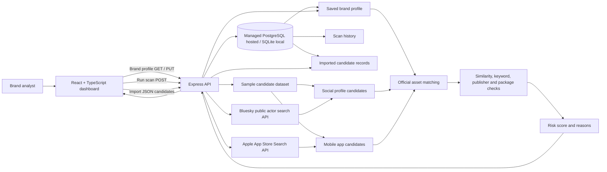

# BrandShield AI — Architecture and Demo Flow

## Architecture

## Data sources and limitations

- Social results come from the **Bluesky public actor search API**; app results come from the **Apple App Store Search API**. These are best-effort public search sources, not comprehensive monitoring, and availability/rate limits are shown in the UI. Provider searches run only when the analyst explicitly starts a scan.
- The checked-in social-profile and app-store candidates are **synthetic demo records** and remain in scans as labeled examples.
- Instagram, Facebook, LinkedIn, X, TikTok, Telegram, Google Play, and Amazon are not connected. Broad monitoring on those services requires additional authorized provider APIs or customer-supplied exports.
- The backend persists brand profiles, imported candidates, and scan history in PostgreSQL when `DATABASE_URL` is configured; local development defaults to SQLite at `data/brandshield.sqlite`. Render's service filesystem is ephemeral, so hosted deployments need managed PostgreSQL. `DATABASE_SSL=true` enables TLS when required by the provider.
- Detection review status and notes still live in browser local storage; they are not shared between users or devices.
- Live monitoring requires authorized provider APIs or customer-supplied exports/connectors. Provider credentials and access approval are not included in this repository.
- The diagram distinguishes API integration points from sources that are currently implemented, so it must not be presented as a live ingestion pipeline.

## Detection and official-asset exclusion

1. Analysts define official names, domains, social accounts, apps, package IDs, publishers, and optional logo in Brand Profile.
2. The profile is saved through the API to PostgreSQL in hosting or SQLite locally, and used for subsequent scans.
3. Analysts can import exported candidates as JSON; the API validates and stores up to 500 candidate records per request.
4. Candidate profiles/apps are checked against official social usernames/URLs and app package IDs/store URLs/name-publisher pairs.
5. Exact registered assets are marked official, receive risk score zero, and are excluded from threat alerts.
6. Remaining candidates are compared using edit distance with adjacent transpositions, name containment, suspicious impersonation terms, scam phrases, verification state, supplied logo-similarity scores, app publisher, and package ID.
7. Analyst-configured name and risk thresholds are applied to each scan.
8. Only candidates with brand-related signals and supporting risk indicators are returned as possible threats. Scores are triage signals, not proof of malicious intent.
9. Each scan reports provider availability and record counts and is saved to SQLite; a failed live provider does not silently masquerade as a live result.

## Short judging demo (about 2 minutes)

1. Open Brand Profile and show the official account, app, package ID, domains, and publisher.
2. Run a scan and call out that the source is the sample dataset, not live platform monitoring.
3. Show that registered official social/app assets are excluded and counted separately.
4. Open Social Monitoring and explain the look-alike/transposition and scam-language indicators.
5. Open App Monitoring and show how similar names plus an unknown publisher/package ID increase risk.
6. Show an unrelated legitimate profile/app remaining unflagged in the detector tests.
7. Close with the production path: authorized social/store API connectors, persistent database, tenant isolation, and operational alerting.
